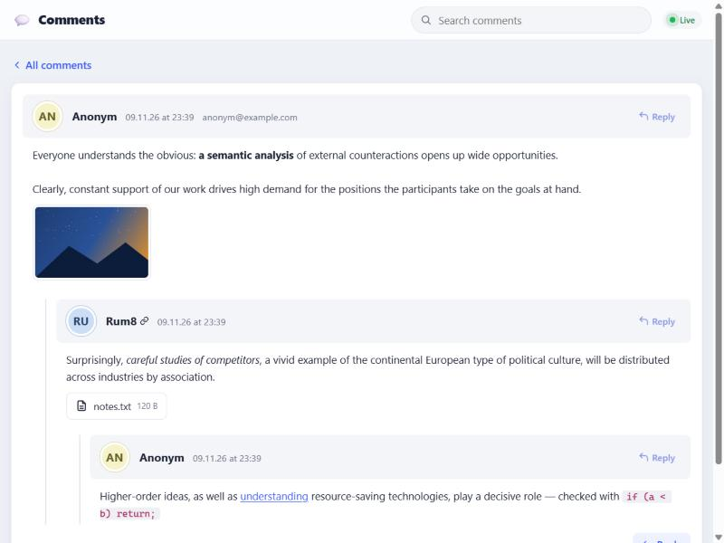
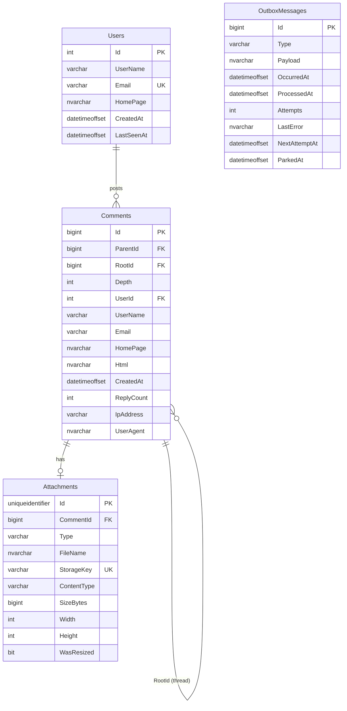

# Comments — a single-page comments app

A comments app built as a single-page application. Users post comments and reply to them at any depth, attach images and text files, see new comments without reloading the page and search the full text. It is designed for a million stored comments and 100,000 users a day, and load-tested at that size.



**Stack:** .NET 10 (ASP.NET Core, EF Core 10, SignalR, Hot Chocolate GraphQL), SQL Server 2022, Redis, RabbitMQ, Elasticsearch, Azure Blob Storage (Azurite locally), Angular 22, Docker, .NET Aspire, k6.

**Live demo:** _not deployed yet_ · **Demo video:** _coming soon_

## Contents

- [Run it](#run-it)
- [Features](#features) — what it does and where it is implemented
- [Architecture](#architecture)
- [Database](#database)
- [API](#api)
- [Security](#security)
- [Load](#load)
- [Tests](#tests)
- [Git branches](#git-branches)
- [Deploying](#deploying)
- [Trade-offs](#trade-offs)

## Run it

### Option 1. Docker only (one command)

You need Docker with at least 6 GB of memory (SQL Server and Elasticsearch need the most).

```bash
git clone <repository URL> comments && cd comments
docker compose up --build
```

After 2–3 minutes (longer the first time, while images download) open <http://localhost:8080>.

This starts SQL Server, Redis, RabbitMQ, Elasticsearch, Azurite (the Blob Storage emulator), the API with the built Angular app, and the worker. Migrations create the database schema when the API starts. The default passwords are for local runs only; for anything reachable from outside, set them in `.env` (see [`.env.example`](.env.example)).

Useful addresses: <http://localhost:8080/scalar> — REST API reference, <http://localhost:8080/graphql> — GraphQL IDE (Nitro), <http://localhost:15672> — RabbitMQ console (`comments` / `comments_dev`).

Stop: `docker compose down` (data stays in the volumes); start from scratch: `docker compose down -v`.

SQL Server runs as **Express** edition by default, which is free for production use (10 GB per database, plenty here). Developer edition is for development only; set `MSSQL_PID=Developer` in `.env` if you want it locally.

Worker maintenance commands (one-off, against the running stack):

```bash
docker compose run --rm worker reindex   # rebuild the search index from SQL Server
docker compose run --rm worker replay    # return dead-lettered events to their queues, release parked outbox rows
```

### Option 2. .NET Aspire (for development)

You need the [.NET 10 SDK](https://dotnet.microsoft.com/download), Node.js 22+ and Docker.

```bash
dotnet run --project src/Comments.AppHost --launch-profile http
```

The AppHost starts the same dependencies in containers, the API, the worker and the Angular dev server (running `npm install` first). The console prints a link to the Aspire dashboard with resources, logs, traces (OpenTelemetry) and links to the app (<http://localhost:4200>) and the API.

## Features

| Feature | How it works | Where |
| --- | --- | --- |
| Comment form: User Name (Latin letters and digits), E-mail, Home page (URL), CAPTCHA, Text | Checked in the browser while typing and on the server by the same rules; server errors appear under their field | [`comment-form.ts`](src/Comments.Web/src/app/comments/comment-form.ts), [`Users/*`](src/Comments.Domain/Users) |
| CAPTCHA (picture, Latin letters and digits) | Drawn on the server (SkiaSharp: rotated letters, noise); the answer lives in Redis for 5 minutes and is removed by the first check (`GETDEL`); case-insensitive | [`CaptchaService.cs`](src/Comments.Infrastructure/Captcha/CaptchaService.cs) |
| Only `<a href title>`, `<code>`, `<i>`, `<strong>`; closing tags checked; valid XHTML | Parsed with regular expressions and a stack of open tags; text and attributes are re-encoded and tags rebuilt, so nothing but the allowed markup reaches the output. All errors at once, in plain words (`Tag <i> is not closed.`) | [`CommentMarkup.cs`](src/Comments.Domain/Markup/CommentMarkup.cs), [tests](tests/Comments.Domain.Tests/CommentMarkupTests.cs) |
| Toolbar `[i] [strong] [code] [a]` | Wraps the selection; Ctrl+I, Ctrl+B, Ctrl+K | `comment-form.html` |
| Preview without reloading | AJAX to the server; shows exactly the XHTML that will be published and updates as you type | `POST /api/comments/preview` |
| Cascading replies of any depth | `ParentId` + `RootId` + `Depth`; a thread loads as one index range and becomes a tree in the browser | [`Comment.cs`](src/Comments.Domain/Comments/Comment.cs), [`thread-tree.ts`](src/Comments.Web/src/app/comments/thread-tree.ts) |
| Top-level comments as a table sortable by User Name, E-mail and date, both ways | A table with sort arrows; each sort has its own index | [`comments-page.html`](src/Comments.Web/src/app/comments/comments-page.html), [`CommentQueries.cs`](src/Comments.Application/Comments/CommentQueries.cs) |
| 25 per page, LIFO by default | Page and sort live in the URL (`?page=2&sort=email&dir=asc`) | — |
| JPG/GIF/PNG image, scaled down proportionally to 320×240 | The type is detected from the content, not the extension; larger images are scaled down and re-encoded (which also drops EXIF and GPS), EXIF rotation is applied; a small GIF is kept as is so its animation survives | [`AttachmentProcessor.cs`](src/Comments.Infrastructure/Files/AttachmentProcessor.cs) |
| TXT up to 100 KB | Size and "is it text" checks; the encoding is detected (UTF-8 or Windows-1251) and named in `Content-Type` | same |
| Viewing files with visual effects | Own lightbox: dimmed backdrop, zoom, arrow keys through every attachment on screen; text files open in it too | [`lightbox.ts`](src/Comments.Web/src/app/shared/lightbox.ts) |
| Protection against XSS and SQL injection | See [Security](#security) | — |
| Who posted | `Users` table (by e-mail) plus IP and User-Agent on every comment | [Database](#database) |
| Plain CSS design with motion | Comment cards, animations for new comments, opening threads, the dialog and errors; responsive down to 360 px | `*.scss` |
| Background work and live updates | Domain event → outbox → RabbitMQ; pages and threads cached in Redis; new comments arrive over WebSocket (SignalR) — the "Live" indicator in the header | [Architecture](#architecture) |
| GraphQL, search, cloud | Hot Chocolate (`/graphql`, the UI's search uses it); RabbitMQ (quorum queue, delayed retries, dead letters with a replay command); Elasticsearch (full-text search with English and Russian stemming); Google Cloud or Azure VM (+ Azure Blob Storage) | [`CommentsQuery.cs`](src/Comments.Api/GraphQL/CommentsQuery.cs), [`deploy/gcp`](deploy/gcp), [`deploy/azure`](deploy/azure) |
| Capacity | Load estimate for 1M comments and 100k users a day, design decisions and k6 results on 1M rows | [docs/architecture.md](docs/architecture.md) |

Also: search across all comments with highlighted matches and a jump to the thread, drag-and-drop upload, upload progress, remembered name and e-mail, rate limits, health checks, OpenTelemetry.

## Architecture

In detail, with a diagram and numbers: **[docs/architecture.md](docs/architecture.md)**.

```
src/
  Comments.Domain/          Entities and rules: Comment, User, Attachment (class hierarchy), value objects, markup parsing
  Comments.Application/     Use cases: posting, pages, threads; interfaces for the infrastructure
  Comments.Infrastructure/  EF Core + SQL Server, outbox, Redis, RabbitMQ, Elasticsearch, Blob Storage, SkiaSharp
  Comments.Api/             ASP.NET Core: REST, GraphQL, SignalR hub, file serving, Angular from wwwroot
  Comments.Worker/          Background work: publishing the outbox, indexing in Elasticsearch, `reindex`
  Comments.Web/             Angular 22 (standalone, signals, zoneless)
  Comments.AppHost/         .NET Aspire: runs everything for development
  Comments.ServiceDefaults/ OpenTelemetry, health checks
tools/Comments.Seed/        Data generator for the load test (SqlBulkCopy)
loadtest/k6/                k6 scenarios
tests/                      Domain unit tests, API integration tests against real containers
```

In short:

- **Writes** do synchronously only what the author needs: validation, storing the file and one transaction (comment, author, outbox message). Search indexing and WebSocket broadcasts run asynchronously through a **transactional outbox → RabbitMQ**. If the broker is down, events wait in the outbox; if Elasticsearch is down, they wait in a retry queue (about an hour of retries, then the dead-letter queue and the `replay` command). Integration tests pause Redis and Elasticsearch to check these paths.
- **Reads**: Redis with versioned regions (one `INCR` after the commit invalidates), a filtered index per sort, a page in two steps (ids from the narrow index, then rows by key). Any Redis failure, including a timeout, falls back to SQL Server.
- **Scaling**: the API is stateless; each API instance has its own queue on the events exchange, so RabbitMQ is the SignalR backplane; the worker scales out with competing consumers.

OOP in the domain: entities guard their invariants (`Comment.Reply`, `Comment.Attach`), values are checked in value objects (`UserName`, `EmailAddress`, `HomePage`), attachments are a hierarchy `Attachment` → `ImageAttachment` / `TextAttachment` (table-per-hierarchy in the database), and the domain event `CommentPosted` becomes an integration event in the infrastructure layer.

## Database

SQL Server; EF Core migrations ([`Persistence/Migrations`](src/Comments.Infrastructure/Persistence/Migrations)) create the schema when the API starts.

- **[docs/database/schema.mysql.sql](docs/database/schema.mysql.sql)** — the model in MySQL syntax for **MySQL Workbench**: `File → Import → Reverse Engineer MySQL Create Script…` builds the EER diagram (or just `File → Open SQL Script`).
- [docs/database/schema.sqlserver.sql](docs/database/schema.sqlserver.sql) — the exact DDL the migrations apply.



Why:

- **The tree is an adjacency list plus `RootId`.** `ParentId` says what was answered; `RootId` gives the whole thread as one range of the `(RootId, Id)` index without a recursive CTE. Relationships never change, so the redundancy is safe. A `CHECK` keeps it consistent: a root has neither parent nor root, a reply has both.
- **The author is stored on the comment.** Name, e-mail and home page are kept as entered when posting, and sorting by them uses an index without a `JOIN`. `Users` is the directory of people (unique case-insensitive e-mail, last seen time).
- **Filtered indexes** `(key, Id) INCLUDE (ParentId) WHERE ParentId IS NULL`, one per sort. `INCLUDE (ParentId)` is not redundant: without it SQL Server re-checks the filter with a key lookup for every row an `OFFSET` skips and prefers scanning the whole table. On a million rows the last page took 7.4 s cold; with it, 0.13 s.
- **Files live in Blob Storage**; the database holds only metadata and the key.

## API

| Method | Path | What it does |
| --- | --- | --- |
| `GET` | `/api/comments?page=&sort=createdAt\|userName\|email&direction=desc\|asc` | A page of top-level comments (25) |
| `GET` | `/api/comments/{id}` | One comment |
| `GET` | `/api/comments/{rootId}/thread?after=` | A thread's replies in id order, up to 200, cursor `nextAfter` |
| `POST` | `/api/comments` | Post, `multipart/form-data`: `userName, email, homePage, text, parentId, captchaId, captchaAnswer, file` |
| `POST` | `/api/comments/preview` | `{ text }` → `{ html, errors }` |
| `GET` | `/api/captcha` | `{ id, image }` — the picture as a data URL |
| `GET` | `/api/search?q=&page=` | Full-text search (Elasticsearch) |
| `GET` | `/files/{images\|texts}/{key}` | An attachment |
| `POST` | `/graphql` | GraphQL: `comments`, `comment`, `thread`, `search` |
| WS | `/hubs/comments` | SignalR: the `commentPosted` event |
| `GET` | `/health`, `/alive` | Readiness and liveness checks |

GraphQL example:

```graphql
query {
  comments(page: 1, sort: USER_NAME, direction: ASC) { totalCount items { id userName replyCount } }
  search(query: "research") { total hits { id snippet } }
}
```

## Security

- **XSS.** Comment text is never passed through: a new XHTML document is built from the allowed tags only, text and attributes are re-encoded, `href` must be `http(s)://` (no `javascript:` or `data:`), and links get `rel="nofollow ugc noopener"`. Angular sanitizes `[innerHTML]` as well. A strict `Content-Security-Policy` (`script-src 'self'`, no inline scripts) would stop a script even if one got through. Elasticsearch escapes search snippets itself (`encoder: html`). User Name is Latin letters and digits only, Home page http(s) only.
- **SQL injection.** All queries are parameterized EF Core; the one hand-written SQL statement (claiming outbox rows) is an interpolated `FromSql`, which is parameterized too. Sorting is an enumeration, not a string: `?sort=Id;DROP TABLE` → `400` (covered by a test).
- **Files.** The type is detected from the content; JPG and PNG are always re-encoded (polyglots and metadata do not survive re-encoding). The one exception is a GIF that already fits 320×240: it is stored as uploaded to keep its animation, after being decoded successfully. The server generates the stored names; every file is served with `X-Content-Type-Options: nosniff` and its decoded type, and text files with `Content-Security-Policy: sandbox`.
- **Abuse.** Single-use CAPTCHA; per-IP rate limits on posting, CAPTCHA, preview, search and `/graphql`; a GraphQL cost budget (one request holds at most a few searches, whatever aliases it uses) and depth limit; request size limits (6 MB for posting, 64 KB for preview); an image pixel limit.
- **Client IP.** `X-Forwarded-For` is trusted only in the cloud setups, where Caddy is the only way in and overwrites the header. Locally the API is published directly, so the header is ignored and cannot be used to dodge rate limits or fake the stored IP.
- **Privacy.** E-mail addresses are public: the list is sortable by e-mail, so they are shown and returned by the API. Posting under someone else's e-mail is possible (there is no confirmation) and updates the name and home page stored in `Users` for that address; each comment keeps what was entered with it. Confirming addresses would be the next step for a real product.
- **CSRF** does not apply: no cookies or sessions, and the CAPTCHA protects posting.

## Load

The estimate, decisions and measurements: **[docs/architecture.md](docs/architecture.md#load-test)**.

The target is a million comments and 100,000 users a day: ~50 rps in the busiest hour, ~150 rps in spikes, about 30 reads per write. A heavier write case, a million *new* comments a day, means ~60 posts a second at peak. On 1,000,000 comments (generator [`tools/Comments.Seed`](tools/Comments.Seed)) the k6 scenario [`loadtest/k6/comments.js`](loadtest/k6/comments.js) covers both, on one machine with one API instance:

| Profile | Load | Errors | p95 list / thread / search / post | Live: write → client, p95 |
| --- | --- | --- | --- | --- |
| `peak` | 171 rps + 500 WebSockets | 0% | 34 / 4 / 65 / 20 ms | 309 ms |
| `write` | 194 rps incl. 60 posts/s + 300 WebSockets | 0% | 51 / 21 / 103 / 45 ms | 722 ms |
| `stress` (×3 peak) | 510 rps + 1,500 WebSockets | 0% | 109 / 64 / 141 / 94 ms | 419 ms |

The mix includes cold threads, long threads read page by page and image uploads; k6 calls the API directly (no Caddy/TLS) with rate limits lifted. The test found two real problems, both fixed: SQL Server ignoring the sort indexes (7.4 s → 0.13 s for a cold last page) and a `COUNT(*)` rerun after every new thread (stress list p95 2.2 s → 109 ms).

To repeat: `docker compose -f docker-compose.yml -f docker-compose.loadtest.yml …` — the commands are in [docs/architecture.md](docs/architecture.md#how-to-repeat).

## Tests

```bash
dotnet test                                                  # needs Docker
cd src/Comments.Web && npm ci && npx ng test --watch=false
```

- **Domain** (64 tests): markup and XHTML rules (including XSS vectors and characters XML forbids), value objects.
- **API** (42 tests): real SQL Server, Redis, RabbitMQ, Elasticsearch and Azurite (Testcontainers), with the worker's background services in the same process. They cover posting, validation of every field, single-use CAPTCHA, sorting and paging, threads, image scaling, files, the outbox (backoff, parking, cleanup), GraphQL and its limits, rate limiting, 404s for unknown API paths, and a comment's whole path: outbox → RabbitMQ → SignalR client and the search index. Failure tests pause Redis (reads fall back to SQL, posting reports the CAPTCHA as unavailable) and Elasticsearch (a comment posted during the outage is indexed afterwards), make the cache fail after a commit (the comment and its file stay), and replay dead letters.
- **Angular** (32 tests, Vitest): client-side markup rules, building the reply tree, the store's handling of live and own comments.

CI ([`.github/workflows/ci.yml`](.github/workflows/ci.yml)) runs all of this and builds the Docker images.

## Git branches

`main` holds releases, `develop` is the integration branch; each piece of work is a branch merged into `develop` with `--no-ff`, so the branching shows in `git log --graph`:

```
v1.0.0   feature/domain-persistence → feature/comments-api → feature/angular-client → feature/messaging-realtime
         → feature/graphql-search → feature/docker-ci → feature/load-test → feature/azure-docs
v1.1.0   hardening: fix/cache-and-post-resilience, fix/search-indexing-retries, fix/outbox-backoff-cleanup,
         fix/input-validation, fix/api-hardening, fix/client-ux, perf/list-cache-and-images, test/load-realism, docs/review-follow-up
         (each → develop; develop → main per release)
```

## Deploying

One VM with docker compose and Caddy in front (automatic HTTPS from Let's Encrypt):

- **[Google Cloud](deploy/gcp/README.md)** — a Compute Engine VM with a static IP and an sslip.io name; attachments stay in Azurite on the VM's disk. The live demo runs here.
- **[Azure](deploy/azure/README.md)** — an Azure VM with its own DNS name; attachments go to Azure Blob Storage.

## Trade-offs

- **Page numbers instead of a cursor.** The list has numbered pages, so it uses `OFFSET` over a narrow index: the cost grows with the page number (the last of 12,000 pages takes 0.13 s cold) but stays acceptable. An endless feed would use keyset paging, as threads already do.
- **The reply counter on the root** is a hot row for a very popular thread (every reply updates the same row). Not a problem at these volumes; beyond them, a counter in Redis flushed to the database periodically.
- **Reply counts in the list may lag by up to 30 seconds.** Replies do not flush the cached list (that would defeat the cache at a high write rate); open pages get the counts live, the thread itself is always fresh.
- **Rate limits are per instance.** Behind a load balancer with N instances the effective limit is N times higher; the CAPTCHA is the main gate.
- **Live updates are best effort.** A client that was disconnected sees missed comments after a reload; there is no redelivery to the browser.
- **Events are delivered at least once and not in order.** The outbox keeps going past a message that fails (it backs off and is parked after 20 attempts), so consumers must be idempotent and order-independent — both are.
- **The CAPTCHA** is home-grown; a high-traffic public site would use reCAPTCHA or Turnstile.
