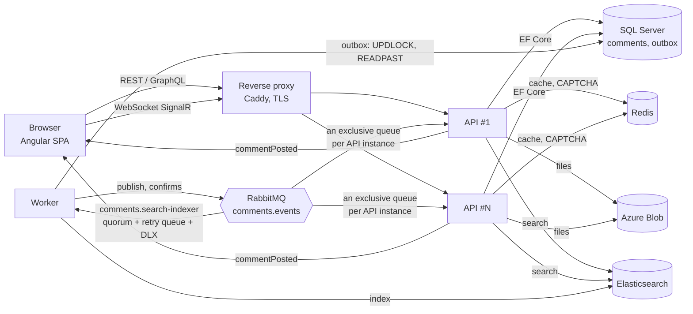

# Architecture and load

The Middle+ condition: **"1,000,000 messages, 100k users in 24 hours"**. Below: how I read it, what it means in requests per second, which design decisions cover it, and what the load test showed.

## How the condition is read

The sentence allows two readings, and the design has to hold under both:

- **A. One million messages stored, 100,000 users a day.** The estimate below is built on this one: the table holds a million comments, and a normal day of 100k users brings reads and ~50k new comments.
- **B. One million new messages a day.** That is 11.6 posts a second on average and, with 12% of the day in the busiest hour, ~33 a second then, ~60 in spikes.

The `peak` and `stress` profiles of the load test model A; the `write` profile models B at its spike rate (60 posts a second on top of reads and 300 live readers). Both run against a database already holding a million comments.

## Diagram



Write path: `POST /api/comments` → validation (fields, CAPTCHA, markup, file) → file to Blob → **one transaction**: comment, author and outbox message → cache invalidation → `201`. Everything else is asynchronous: the worker publishes the outbox to RabbitMQ, then Elasticsearch indexing and WebSocket broadcasts by each API instance to its own clients.

Read path: `GET /api/comments` (a page of top-level comments) and `GET /api/comments/{id}/thread` (a thread) → Redis → on a miss, SQL Server through an index built for that query.

## Load estimate (reading A)

| Assumption | Value |
| --- | --- |
| Unique users a day | 100,000 |
| List views per user | 10 |
| Threads opened per user | 4 |
| Searches per user | 0.2 |
| Comments per user | 0.5 → 50,000 a day |
| Share of traffic in the busiest hour | 12% of the day (a typical daily curve) |
| Spikes within the hour | ×3 the hourly average |
| Average session | 8 minutes |

| Stream | Daily average | Busiest hour | Spike |
| --- | --- | --- | --- |
| List reads | 11.6 rps | 33 rps | ~100 rps |
| Thread reads | 4.6 rps | 13 rps | ~40 rps |
| Search | 0.2 rps | 0.7 rps | ~2 rps |
| Posting (+ CAPTCHA request) | 0.6 rps | 1.7 rps | ~5 rps |
| Concurrent WebSockets | ~560 | ~1,600 | — |

Conclusion: the system reads about 30 times more often than it writes; the absolute numbers are modest (hundreds of rps), but **a million rows make naive queries expensive**: `OFFSET` over full rows, `ORDER BY` without an index, `LIKE '%word%'` and `COUNT(*)` on every request. So the main work is not "holding rps" but keeping the cost of a query from growing with the table.

The k6 `peak` profile has headroom over the spike: 120 rps of list reads, 50 rps of thread reads (some of them several pages of a long thread), 10 rps of search, 4 posts a second and 500 open WebSockets. `stress` is three times that.

## Decisions

### Reads (≈97% of requests)

- **An index per sort.** The table of top-level comments sorts by User Name, E-mail and date, both ways. Each key has a filtered index `(key, Id) INCLUDE (ParentId) WHERE ParentId IS NULL`: it holds only top-level rows (~30%), and `ORDER BY key, Id` is a scan of it in the right direction, with no sort. The `INCLUDE` matters, see [What the test found](#what-the-test-found).
- **Deferred join.** A page is read in two steps: first 25 `Id`s from the narrow index (`OFFSET` skips only ~20-byte index entries), then the 25 full rows by primary key. A direct `OFFSET` over full rows would drag along the text of every skipped row.
- **Denormalized author.** Name, e-mail and home page are stored on the comment (as entered when posting), so sorting by them needs no `JOIN Users`. `Users` remains the source of "who is this" (unique e-mail).
- **Reply counter.** The root's `ReplyCount` grows by an atomic `UPDATE … SET ReplyCount = ReplyCount + 1` in the same transaction instead of a `COUNT` per row.
- **A thread from one index.** Every reply has a `RootId`; a thread is a range of `(RootId, Id)` with keyset paging by 200. Identity order guarantees parents come before children, and the client builds the tree in one pass.
- **Redis.** Pages and threads are cached under a region version; a write `INCR`s the version only after the commit, so stale data can never sit under the live version. A new thread invalidates the list; a reply invalidates only its thread, and list pages expire after 30 seconds, so reply counts in the list may lag by that much while open pages get them live. (Flushing the list on every reply would make its cache live for a second or two at the reading-B write rate.) Concurrent misses for one key in a process run one database query (single flight). If Redis is down or slow — including timeouts, which StackExchange.Redis reports as `RedisTimeoutException`, a `TimeoutException` — reads go straight to SQL; a test pauses the Redis container to check this.
- **Thread count without `COUNT(*)`.** The total for the pager is a Redis counter: loaded once with `COUNT`, incremented by each new thread, reloaded every 10 minutes. A cached `COUNT` was recomputed after every new thread and was the largest SQL cost under load (see the results).
- **Search in Elasticsearch.** `LIKE '%word%'` on a million rows is a full scan; an ES index with English and Russian analyzers finds word forms and highlights matches (HTML-escaped by ES).

### Writes (≈3% of requests in reading A)

- **Only what the author needs is synchronous**: check, store, answer. Nothing after the commit can fail the request: if the cache invalidation fails, the comment and its file stay, and the pages expire on their own.
- **Transactional outbox instead of a dual write.** The event is written to `OutboxMessages` in the same transaction as the comment, so there is never "a comment without its event" or the reverse. The worker claims batches with `UPDLOCK, READPAST` (several workers share the work without duplicates), publishes with publisher confirms and marks a row only after the confirm. Delivery is at-least-once and consumers are idempotent and order-independent (the ES document is keyed by comment id, the UI ignores a repeated event).
- **A failing outbox message does not block the rest.** It is retried with exponential backoff (2 s … 5 min) and parked after 20 attempts; a closed channel (broker down) stops the batch without counting attempts. Published rows are deleted after 7 days in batches of 5,000, so the table does not grow by ~50k rows of HTML a day.
- **Indexing survives an Elasticsearch outage.** A failed event goes to a retry queue (per-message TTL, then back to the work queue) and is retried every 15 s for about an hour; only then is it dead-lettered. The worker's `replay` command returns dead letters to their queue and releases parked outbox rows. A test pauses Elasticsearch, posts a comment and finds it by search after Elasticsearch is back.
- **Files outside the database.** Images are scaled down and re-encoded on upload, stored in Blob Storage and served with `Cache-Control: immutable` (random keys), so they can sit behind a CDN. Large JPEGs are decoded directly at 1/2–1/8 size, at most 24 MP are accepted and only a few images decode at a time, so big uploads cannot exhaust the API's memory.

### Scaling

- **A stateless API.** CAPTCHA and cache live in Redis, files in Blob, there are no sessions. Any number of API instances can run behind a load balancer.
- **WebSockets across instances.** Each API instance binds its own exclusive queue to the `comments.events` exchange and broadcasts events to its own connections. RabbitMQ is the SignalR backplane; no separate Redis backplane is needed.
- **The worker scales out.** Competing consumers on the quorum queue; the outbox is shared through `READPAST`.
- **Migrations are safe on parallel start.** EF Core takes a lock while migrating.

### If the load grows ×10–×100

- SQL Server read replicas (Always On / Azure SQL geo-replica) for pages and threads.
- Keyset paging instead of page numbers for deep pages: `OFFSET` grows linearly with the page number (see the measurements), and the task asks for page numbers.
- Azure SignalR Service instead of our own WebSocket connections, a Redis cluster, a 3-node ES cluster, a CDN for `/files` and static files.
- Bulk indexing (hundreds of events per request) instead of one by one, partitioning `Comments` by date, a Redis counter for very hot threads instead of updating the root row on every reply.

## Load test

Scenario: [`loadtest/k6/comments.js`](../loadtest/k6/comments.js); data: [`tools/Comments.Seed`](../tools/Comments.Seed) — 1,000,000 comments (≈300k threads, ≈700k replies, 20 popular threads of about a thousand replies each, nesting up to 12) and 100,000 users, loaded with `SqlBulkCopy` in about a minute.

The request mix:

- **List:** 60% the first page, 25% pages 2–20 with a random sort, 15% random deep pages up to the last (~12,000), which are cache misses.
- **Threads:** 50% recent threads (likely cached), 25% threads sampled from random deep pages (cold), 25% the long popular threads, read page by page (up to three pages of 200).
- **Search:** a word list.
- **Posting:** 30% replies (a fifth of them into the long threads), 10% with a JPEG that has to be scaled down, 10% with a text file. Every post first fetches a CAPTCHA picture, which the server draws.
- **Live readers** hold SignalR connections and measure the time from writing a comment to receiving its event.

What the numbers do not include: k6 calls the API directly, without Caddy and TLS, and with the load-test overlay, which lifts rate limits and returns CAPTCHA answers. SQL Server runs as Developer edition in this overlay (deployments use Express).

**Where:** one desktop (Intel Core i5-11400F, 6 cores / 12 threads, 16 GB), Docker Desktop on Windows 11 with an 8 GB limit for all containers. One API instance, one worker, SQL Server 2022 in a container, Elasticsearch with a 512 MB heap, k6 on the same machine. That is clearly weaker than a production server, and k6 takes some of the CPU.

| Profile | Load | Errors | p95 list | p95 thread | p95 search | p95 post | Live: write → client, p95 |
| --- | --- | --- | --- | --- | --- | --- | --- |
| `peak` | 171 rps, 500 WebSockets, 810 posts | 0% | 34 ms | 4 ms | 65 ms | 20 ms | 309 ms (404,501 events) |
| `write` (reading B) | 194 rps incl. 60 posts/s, 300 WebSockets, 12,149 posts | 0% | 51 ms | 21 ms | 103 ms | 45 ms | 722 ms (3.64M events) |
| `stress` (×3 peak) | 510 rps, 1,500 WebSockets, 2,421 posts | 0% | 109 ms | 64 ms | 141 ms | 94 ms | 419 ms (3.63M events) |

Every live event reached every connected reader (events received = posts × readers). The reports are in [`docs/loadtest`](loadtest).

**Thread count.** The first runs of this mix found the next bottleneck: SQL Server at 5 of 12 cores, mostly in `COUNT(*)` over the top-level index (~75 ms of CPU each, ~10,000 runs, ~750 s of CPU across the `write` and `stress` runs). The cached count was recomputed after every new thread, and in `write` that is ~40 times a second. `stress` failed its thresholds (list p95 2.2 s, live delivery p95 13 s) and `write` had a list p95 of 175 ms. Keeping the count as a Redis counter, loaded once and incremented by each new thread, brought `stress` back under its thresholds and `write`'s list p95 to 51 ms; the earlier reports are `stress-before-counter.json` and `write-before-counter.json`. The next SQL cost is deep pages: `OFFSET` into a random one of ~12,000 pages costs ~30 ms of CPU, which is the price of page numbers (see "If the load grows").

**Cold start.** Right after flushing SQL Server's buffer pool, the first seconds of a run show outliers of several seconds while data pages are read from disk; after warm-up there are none. The table above is from warm runs.

### What the test found

Before the first load run, the cold last page sorted by name took 7.4 s: the plan showed a scan of the whole table with a sort instead of the filtered index. The cause: SQL Server re-checks the `ParentId IS NULL` filter with a key lookup for every row an `OFFSET` skips when the filter column is not in the index. After `INCLUDE (ParentId)` (migration `IncludeFilterColumnsInFilteredIndexes`) the same page takes 0.13 s cold and ~10 ms from the cache.

**Data size.** 1M comments take ~950 MB in SQL Server (745 MB of data, 180 MB for all indexes; the three filtered sort indexes are 10–26 MB each). Generating and loading: ~1 minute; reindexing in Elasticsearch: ~2.5 minutes.

### How to repeat

```bash
docker compose -f docker-compose.yml -f docker-compose.loadtest.yml up -d --build
docker compose -f docker-compose.yml -f docker-compose.loadtest.yml run --rm seed --comments 1000000 --users 100000
docker compose -f docker-compose.yml -f docker-compose.loadtest.yml run --rm worker reindex
docker compose -f docker-compose.yml -f docker-compose.loadtest.yml run --rm k6                        # peak profile
LOAD_PROFILE=write docker compose -f docker-compose.yml -f docker-compose.loadtest.yml run --rm k6    # 60 posts a second
LOAD_PROFILE=stress docker compose -f docker-compose.yml -f docker-compose.loadtest.yml run --rm k6   # three times peak
```

The seed writes the popular thread ids to `loadtest/results/popular-threads.json`, which k6 reads; full k6 results (JSON) go to `loadtest/results/`.
