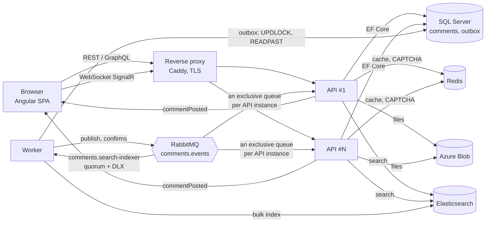

# Architecture and load

The Middle+ condition: **1,000,000 messages and 100,000 users a day**. Below: what that means in requests per second, which design decisions cover it, and what the load test showed.

## Diagram



Write path: `POST /api/comments` → validation (fields, CAPTCHA, markup, file) → file to Blob → **one transaction**: comment, author and outbox message → cache version bump → `201`. Everything else is asynchronous: the worker publishes the outbox to RabbitMQ, then Elasticsearch indexing and WebSocket broadcasts by each API instance to its own clients.

Read path: `GET /api/comments` (a page of top-level comments) and `GET /api/comments/{id}/thread` (a thread) → Redis → on a miss, SQL Server through an index built for that query.

## Load estimate

| Assumption | Value |
| --- | --- |
| Unique users a day | 100,000 |
| List views per user | 10 |
| Threads opened per user | 4 |
| Searches per user | 0.2 |
| Comments per user | 0.5 → 50,000 a day |
| Share of traffic in the busiest hour | 12% of the day (a typical daily curve) |
| Spikes within the hour | ×3 the hourly average |
| Average session | 8 minutes |

| Stream | Daily average | Busiest hour | Spike |
| --- | --- | --- | --- |
| List reads | 11.6 rps | 33 rps | ~100 rps |
| Thread reads | 4.6 rps | 13 rps | ~40 rps |
| Search | 0.2 rps | 0.7 rps | ~2 rps |
| Posting (+ CAPTCHA request) | 0.6 rps | 1.7 rps | ~5 rps |
| Concurrent WebSockets | ~560 | ~1,600 | — |

Conclusion: the system reads about 30 times more often than it writes; the absolute numbers are modest (hundreds of rps), but **a million rows make naive queries expensive**: `OFFSET` over full rows, `ORDER BY` without an index, `LIKE '%word%'` and `COUNT(*)` on every request. So the main work is not "holding rps" but keeping the cost of a query from growing with the table.

The k6 `peak` profile has headroom over the spike: 120 rps of list reads, 50 rps of threads, 10 rps of search, 4 posts a second and 500 open WebSockets. The `stress` profile is three times that.

## Decisions

### Reads (≈97% of requests)

- **An index per sort.** The table of top-level comments sorts by User Name, E-mail and date, both ways. Each key has a filtered index `(key, Id) WHERE ParentId IS NULL`: it holds only top-level rows (~30%), and `ORDER BY key, Id` is a scan of it in the right direction, with no sort.
- **Deferred join.** A page is read in two steps: first 25 `Id`s from the narrow index (`OFFSET` skips only ~20-byte index entries), then the 25 full rows by primary key. A direct `OFFSET` over full rows would drag along the text of every skipped row.
- **Denormalized author.** Name, e-mail and home page are stored on the comment (as entered when posting), so sorting by them needs no `JOIN Users`. `Users` remains the source of "who is this" (unique e-mail).
- **Reply counter.** The root's `ReplyCount` grows by an atomic `UPDATE … SET ReplyCount = ReplyCount + 1` in the same transaction instead of a `COUNT` per row.
- **A thread from one index.** Every reply has a `RootId`; a thread is a range of `(RootId, Id)` with keyset paging by 200. Identity order guarantees parents come before children, and the client builds the tree in one pass.
- **Redis.** Pages and threads are cached under a region version; a write `INCR`s the version only after the commit, so stale data can never sit under the live version. Concurrent misses for one key in a process run one database query (single flight). If Redis is unavailable, reads go straight to SQL.
- **Search in Elasticsearch.** `LIKE '%word%'` on a million rows is a full scan; an ES index with English and Russian analyzers finds word forms and highlights matches (HTML-escaped by ES).

### Writes (≈3% of requests)

- **Only what the author needs is synchronous**: check, store, answer. Indexing and broadcasting do not delay the response and do not fail it if ES or the broker is down for a while.
- **Transactional outbox instead of a dual write.** The event is written to `OutboxMessages` in the same transaction as the comment, so there is never "a comment without its event" or the reverse. The worker claims batches with `UPDLOCK, READPAST` (several workers share the work without duplicates), publishes with publisher confirms and marks a row only after the confirm. Delivery is at-least-once and consumers are idempotent (the ES document is keyed by comment id, the UI ignores a repeated event).
- **A reliable queue.** The indexer reads a quorum queue with `x-delivery-limit`: after 5 failed deliveries a message goes to the dead-letter queue instead of spinning forever.
- **Files outside the database.** Images are scaled down and re-encoded on upload, stored in Blob Storage and served with `Cache-Control: immutable` (random keys), so they can sit behind a CDN.

### Scaling

- **A stateless API.** CAPTCHA and cache live in Redis, files in Blob, there are no sessions. Any number of API instances can run behind a load balancer.
- **WebSockets across instances.** Each API instance binds its own exclusive queue to the `comments.events` exchange and broadcasts events to its own connections. RabbitMQ is the SignalR backplane; no separate Redis backplane is needed.
- **The worker scales out.** Competing consumers on the quorum queue; the outbox is shared through `READPAST`.
- **Migrations are safe on parallel start.** EF Core takes a lock while migrating.

### If the load grows ×10–×100

- SQL Server read replicas (Always On / Azure SQL geo-replica) for pages and threads.
- Keyset paging instead of page numbers for deep pages: `OFFSET` grows linearly with the page number (see the measurements), and the task asks for page numbers.
- Azure SignalR Service instead of our own WebSocket connections, a Redis cluster, a 3-node ES cluster, a CDN for `/files` and static files.
- Bulk indexing (500 events per request) instead of one by one, partitioning `Comments` by date.

## Load test

Scenario: [`loadtest/k6/comments.js`](../loadtest/k6/comments.js); data: [`tools/Comments.Seed`](../tools/Comments.Seed) — 1,000,000 comments (≈300k threads, ≈700k replies, 20 popular threads of about a thousand replies each, nesting up to 12) and 100,000 users, loaded with `SqlBulkCopy` in about a minute.

The request mix: 60% views of the first page, 25% pages 2–20 with a random sort, 15% random deep pages (cache misses, up to the last page ~12,000); 70% of opened threads are recent, 30% random ids; search over a word list; 30% of posts are replies, 10% carry a text file. Readers hold SignalR connections and measure the time from writing a comment to receiving its event.

**Where:** one desktop (Intel Core i5-11400F, 6 cores / 12 threads, 16 GB), Docker Desktop on Windows 11 with an 8 GB limit for all containers. One API instance, one worker, SQL Server 2022 in a container, Elasticsearch with a 512 MB heap, k6 on the same machine. That is clearly weaker than a production server, and k6 takes some of the CPU.

| Profile | Load | Errors | p95 list | p95 thread | p95 search | p95 post | Live: write → client, p95 |
| --- | --- | --- | --- | --- | --- | --- | --- |
| `peak` | 171 rps, 500 WebSockets, 810 posts | 0% | 32 ms | 3 ms | 53 ms | 16 ms | 309 ms (404,500 events) |
| `stress` | 513 rps, 1,500 WebSockets, 2,427 posts | 0% | 108 ms | 50 ms | 95 ms | 63 ms | 389 ms (3.64M events) |

The maximums in `peak` were 128 ms for HTTP and 364 ms for live events. In `stress` k6 failed to start 47 of ~113,000 iterations (0.04%) because it ran out of pre-allocated VUs; the server returned no errors. During `stress` the API used ~1.5 cores, SQL Server ~2 and Elasticsearch ~1, so there is still hardware headroom.

**Cold start.** I ran the first `peak` right after flushing SQL Server's buffer pool and plan cache (`DBCC DROPCLEANBUFFERS`, `FREEPROCCACHE`) and with 500 WebSocket clients connecting at once. The p95 values stayed the same, but the first seconds produced outliers up to 8.6 s and a live-delivery p95 of 3.2 s while data pages were read from disk. After warm-up there are no such outliers. The k6 reports are in [`docs/loadtest`](loadtest): `peak-cold.json`, `peak.json`, `stress.json`.

**What the test found.** Before the load run, the cold last page sorted by name took 7.4 s: the plan showed a scan of the whole table with a sort instead of the filtered index. The cause: SQL Server re-checks the `ParentId IS NULL` filter with a key lookup for every row an `OFFSET` skips when the filter column is not in the index. After `INCLUDE (ParentId)` (migration `IncludeFilterColumnsInFilteredIndexes`) the same page takes 0.13 s cold and ~10 ms from the cache.

**Data size.** 1M comments take ~950 MB in SQL Server (745 MB of data, 180 MB for all indexes; the three filtered sort indexes are 10–26 MB each). Generating and loading: ~1 minute; reindexing in Elasticsearch: ~2.5 minutes.

### How to repeat

```bash
docker compose -f docker-compose.yml -f docker-compose.loadtest.yml up -d --build
docker compose -f docker-compose.yml -f docker-compose.loadtest.yml run --rm seed --comments 1000000 --users 100000
docker compose -f docker-compose.yml -f docker-compose.loadtest.yml run --rm worker reindex
docker compose -f docker-compose.yml -f docker-compose.loadtest.yml run --rm k6                       # peak profile
LOAD_PROFILE=stress docker compose -f docker-compose.yml -f docker-compose.loadtest.yml run --rm k6  # three times more
```

Full k6 results (JSON) go to `loadtest/results/`.
